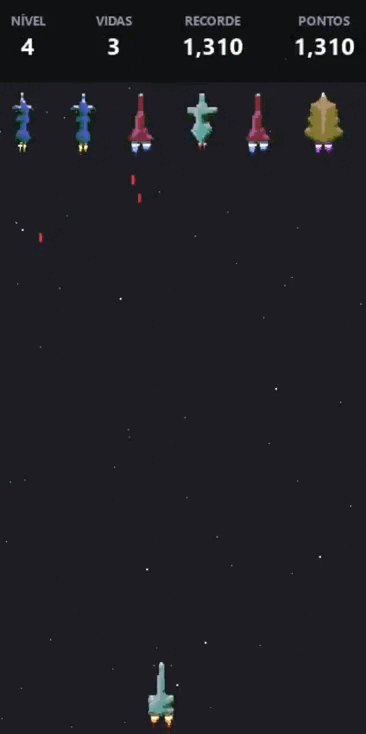
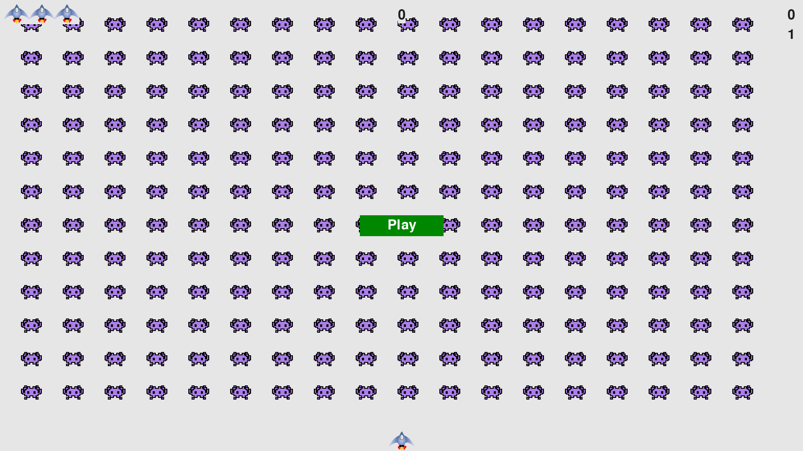
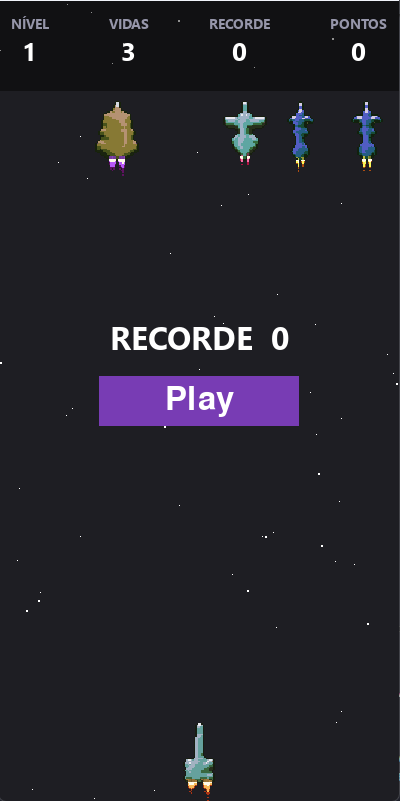

# Alien Invasion

Jogo de naves no formato de celular, feito em Python com pygame. Começou como estudo de programação orientada a objetos e de pygame, a partir de um exercício do livro *Python Crash Course*, e foi crescendo aos poucos.

<p align="center">
  
</p>

## Versões

### Versão 1.0

Base do exercício do *Python Crash Course*, seguida de depuração e ajustes. Cada correção foi versionada no Git.


*Versão 1.0: tela cheia, naves simples e frota em grade.*

### Versão 2.0

Reformulação visual e de mecânicas:

- **Naves open source:** substituídas por sprites do gerador [Pixelship](https://github.com/stmn/pixelship). O código lê uma sheet com vários designs e recorta cada nave pelo tamanho do próprio desenho.
- **Frotas sorteadas:** cada alien recebe um design diferente da sheet.
- **Tela em formato de celular:** com fundo cinza escuro e estrelas em movimento.
- **Ondas de aliens:** começam com uma fileira e, nos níveis seguintes, podem ter duas. Um alien por vez se separa da formação e desce na direção da nave.
- **Tiros em rajada:** cada alien atira de 1 a 4 tiros por vez. Os tiros caem em linha reta, e a dificuldade aumenta a cada nível.
- **Explosões em partículas:** os aliens e a nave se desfazem em pixels.
- **Efeitos sonoros:** tiro da nave e explosão da nave.
- **Painel superior:** nível, vidas, recorde e pontuação em uma linha.
- **Tela inicial:** mostra o recorde e tem o botão Play em roxo.
- **Aviso entre ondas:** "NÍVEL X" aparece por 1 segundo antes da nova onda.
- **Tiro contínuo:** segure a barra de espaço para atirar sem parar.

## Como jogar

| Tecla | Ação |
|---|---|
| ← → | Move a nave |
| Espaço | Atira (segure para atirar continuamente) |
| Mouse | Clica em Play para começar |
| Q | Sai do jogo |

O objetivo é destruir a frota antes que ela atinja a sua nave. Você tem 3 vidas.

## Como rodar

Requisitos: Python 3.10 ou superior e pygame.

```bash
pip install pygame
python alien_invasion.py
```

## Estrutura

- `alien_invasion.py`: loop principal e regras do jogo
- `alien.py`: comportamento dos aliens (formação, descida e tiros)
- `ship.py` e `bullet.py`: nave do jogador e seus tiros
- `enemy_bullet.py`: tiros dos aliens
- `sprites.py`: lê e recorta a sheet de naves
- `explosion.py`: efeito de partículas
- `starfield.py`: fundo estrelado
- `scoreboard.py`, `button.py`, `settings.py` e `game_stats.py`: painel, botão, configurações e estatísticas

## O que aprendi

- Organizar o código em classes, cada uma com uma responsabilidade.
- Controlar o tempo com `pygame.time.get_ticks()`, para tiros, animações e pausas, sem travar o jogo.
- Usar grupos de sprites (`Group`) para detectar colisões e desenhar muitos objetos.
- Separar configurações fixas e dinâmicas, para aumentar a dificuldade sem mexer no código.
- Versionar o projeto com Git e GitHub, criando commits a cada mudança.

## Créditos

- Naves: [Pixelship](https://stmn.itch.io/pixelship) by stmn (open source).
- Sons: OpenGameArt, licença CC0.
- Livro base da versão 1.0: *Python Crash Course*, de Eric Matthes.
- Engine: [pygame](https://www.pygame.org).

 <br>
<p align="center">
  
  <br>
  <em>Versão 2.0: tela adaptada para celular.</em>
</p>

